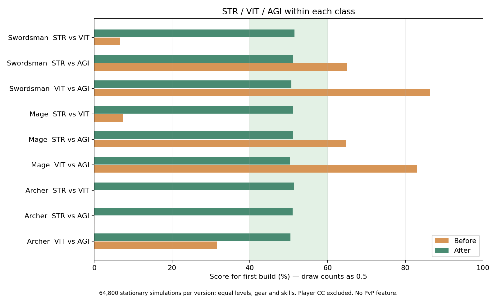

# สมดุล STR / VIT / AGI ภายในทุกอาชีพ

สูตรเดิมไม่สมดุล: 311 จาก 324 เงื่อนไขมีคะแนนผลดวลนอกช่วง 40–60% โดยนักธนูลง STR ไม่เพิ่มดาเมจหลัก, VIT เพิ่ม HP และ DEF ทบกันแรงเกินไป และ AGI ได้ประโยชน์ต่างกันมากระหว่างการโจมตีธรรมดากับสกิล

สูตรสุดท้ายผ่านทั้ง 396 เงื่อนไข รวม 79,200 รอบ: ชุดหลัก 324 เงื่อนไข × 200 รอบ ที่เลเวล 20/50/100 และชุดเพิ่มเติม 72 เงื่อนไข × 200 รอบ สำหรับเลเวล 100 สกิล Rank 5 ไม่มีคู่ที่หมดเวลาโดยยังไม่จบการต่อสู้

## ผลภายในแต่ละอาชีพ

คะแนนของสายที่ระบุเป็นตัวแรก: ชนะ = 1, แพ้ = 0, ตายพร้อมกัน = 0.5 คะแนน ไม่ใช่อัตราชนะที่ตัดผลเสมอออก คะแนนเฉลี่ยจากชุดหลัก:

| อาชีพ | STR vs VIT | STR vs AGI | VIT vs AGI |
| --- | ---: | ---: | ---: |
| นักดาบ | 51.51% | 51.13% | 50.72% |
| นักเวท | 51.10% | 51.21% | 50.35% |
| นักธนู | 51.39% | 51.03% | 50.47% |

ทุกกรณีของชุดหลักอยู่ที่ 42.75–59.50% และ Rank 5 อยู่ที่ 47.50–57.75%. ชุดหลักมีตายพร้อมกัน 37,359/64,800 รอบ (57.7%). หากนับเฉพาะรอบที่ตัดสินผู้ชนะ คะแนนชนะเฉลี่ยของแต่ละคู่/อาชีพอยู่ประมาณ 50.8–53.7%.



## การเปลี่ยนสูตร

ทุกแต้มที่ลงจริงเพิ่มฐานโจมตีร่วม แล้วเพิ่มลักษณะเฉพาะของสาย:

- STR: เพิ่มพลังโจมตีทุกอาชีพ รวมธนู; นักดาบ/นักเวทที่ลง STR อย่างเดียวทั้งเต็มและบางส่วนยังได้ Attack เท่ากับสูตรเดิม
- VIT: เพิ่ม HP และการลดดาเมจจาก DEF ด้วยงบพลังเดียวกัน ลดการทบกันของโบนัสสองส่วน; เพิ่มแต้มอื่น ใส่อาวุธ หรือเลเวลอัปไม่ลดพลังจาก VIT เดิม
- AGI: เพิ่มความแรงและโอกาสคริติคอลของทั้งโจมตีธรรมดาและสกิล; แต้ม AGI ไม่เพิ่มความถี่โจมตีโดยตรงแล้ว ส่วน AGI/attack-speed จากอุปกรณ์ยังใช้เส้นความเร็วเดิมและเพดานเดิม

ค่าจูน: `pointPower=1.00075`, `vitalityArmorShare=0.1`, `agilityCriticalShare=0.15`, `agilityCadenceShare=0`. เต็ม 300 แต้มที่เลเวล 100 ให้พลังเฉพาะสายรวมประมาณ 25.2% เหนือฐานร่วม; สาย VIT แบ่งเป็น HP และเกราะ ส่วน AGI แบ่งเป็นดาเมจและคริติคอล

เมื่อ `T` คือแต้มที่ลงจริง, `A` คือฐานโจมตีเดิมรวมอุปกรณ์ และ `P=1.00075`, ฐานร่วมเป็น `(A + atkPrimary*T) / P^T`. โบนัสแต่ละสถานะใช้ `P^แต้มที่ลง` จึงลงผสมแล้วไม่สร้างตัวคูณฟรี, ยังไม่ลงแต้มไม่รับพลังโจมตีเพิ่มอัตโนมัติ และ STR-only คืนสูตร `A + atkPrimary*T` เดิม ไม่แก้ตัวเลขแต้ม/สถานะที่เก็บในเซฟ; ข้อมูลนำเข้าที่เกินงบเลเวลใช้การคำนวณสัดส่วนภายในงบ ไม่เขียนทับเซฟ

ใช้สูตรเดียวกันใน Simulation, ตัวเลขโบนัสอุปกรณ์ และ max HP ของ peers ฝั่งเซิร์ฟเวอร์ พร้อม cache ที่เปลี่ยนตามเลเวล สถานะ อาชีพ อุปกรณ์และ refinement. Snapshot peers ไม่สร้าง Simulation/world ใหม่เพื่อคำนวณ HP

## วิธีทดสอบและข้อจำกัด

เกมยังไม่มีเป้าหมายผู้เล่นสำหรับ PvP จึงเป็น **การจำลองแลกดาเมจแบบยืนในระยะโจมตี** ด้วย actor, การรับ/ปล่อยสกิล, recovery, cooldown, MP, regen, poison และสูตรดาเมจจริง แทน receiver มอนสเตอร์ด้วยค่า HP/DEF/dodge/reduction ของคู่ต่อสู้ ไม่สร้างระบบ PvP หรือแก้บัญชีผู้เล่น

แต่ละคู่มีอาชีพเดียวกัน เลเวล/อุปกรณ์/สกิล/Rank เท่ากัน ลงแต้มที่ได้รับตามกติกาทั้งหมดใน STR, VIT หรือ AGI ผ่าน `Simulation.stat`. ทดสอบทั้งโจมตีธรรมดาและทั้งสองสายสกิล ใช้ hotbar หกสกิลล่าสุดที่เรียนได้, timestep 25ms ตาม server; damage จากทั้งสองฝั่ง commit พร้อมกันเพื่อไม่ให้ลำดับ actor ตัดสินผู้ชนะ. สวิงที่หลบได้ยังเสีย normal recovery; ไม่มีค่าโบนัสเฉพาะคู่ต่อสู้

ชุดอุปกรณ์: ไม่มี / common ครบหกชิ้นตามเลเวล / legend +10 แบบตัด affix เพื่อแยกผล primary stats / legend +10 ที่สุ่มห้า affix จริงต่อชิ้นด้วย seed เดียวกัน. ทดสอบชุดหลัก Rank 1 ที่เลเวล 20/50/100 และ Rank 5 ของทั้งสองสายที่เลเวล 100

ไม่จำลองการวิ่งไล่หรือ kite และไม่ใส่ stun/slow ให้ผู้เล่น เพราะเกมยังไม่มีกติกา PvP สำหรับสถานะเหล่านั้น; poison คงอยู่. ผลนี้รับรองสมดุลตามสูตรและเงื่อนไขที่ทดสอบ ไม่ใช่การทดสอบ PvP ออนไลน์. ผลตายพร้อมกันสูงต้องอ่านควบคู่กับจำนวนชนะ/แพ้/เสมอใน JSON ไม่เรียกคะแนน 50% ว่าชนะ 50% โดยไม่ระบุเสมอ

การเพิ่มตัวอย่างเฉพาะ naked Lv100 สายสกิล B, STR vs AGI จำนวน 1,000 รอบต่ออาชีพ ช่วยลด bias ของจังหวะสกิล+โจมตี: critical share 0.30 ได้คะแนน 61.75% ส่วน 0.15 ได้ 56.35%. ตัวเลขนี้เป็น sensitivity เพิ่มเติม ใช้เลือกค่าจูนก่อนทดสอบชุดเต็ม ไม่แทนที่ผลชุดเต็ม

## ผลต่อมอนสเตอร์

เปรียบเทียบการสู้มอนสเตอร์ปกติระดับเดียวกันผ่าน tick/hit/AI จริง ไม่ใช้ยา/วิ่งหลบ: 216 เงื่อนไข × 30 รอบต่อสูตร. เวลาเฉลี่ยที่ Lv100 ใส่ชุด common ทั้งหกชิ้นและใช้สกิล Rank 1 (วินาที):

| อาชีพ/สาย | ก่อน | หลัง |
| --- | ---: | ---: |
| swordsman STR | 12.3 | 12.3 |
| swordsman VIT | 27.9 | 15.9 |
| swordsman AGI | 18.8 | 12.2 |
| mage STR | 15.5 | 15.5 |
| mage VIT | 33.7 | 19.5 |
| mage AGI | 21.8 | 15.2 |
| archer STR | 27.4 | 11.5 |
| archer VIT | 27.4 | 15.6 |
| archer AGI | 7.3 | 11.5 |

ทั้งเก้าชุดในตารางฆ่ามอนสเตอร์ได้ 30/30 รอบ. นักดาบ/นักเวท STR รักษาเวลาการสู้เดิม; นักธนู STR ได้พลังโจมตีที่เคยขาด ส่วน AGI นักธนูที่เคยรับทั้งดาเมจ/ความเร็ว/คริติคอลจากแต้มเดียวใช้เวลานานขึ้นตามการปรับสมดุล. อุปกรณ์ยังสำคัญและชุดไม่มีอุปกรณ์ที่เลเวลสูงบางชุดแพ้มอนสเตอร์ จึงไม่ตีความผลนี้ว่าทุกสภาพตัวละครสู้มอนสเตอร์ได้เหมือนกัน

## หลักฐานและการตรวจรับ

Baseline: `11b05a0edce4de7ccfb0a564a1b2e535fd024440` บน `mossvale-latest`. ข้อมูลเต็มอยู่ใน [summary.json](../artifacts/attribute-balance/summary.json), [before-full.json](../artifacts/attribute-balance/before-full.json), [after.json](../artifacts/attribute-balance/after.json), [max-rank.json](../artifacts/attribute-balance/max-rank.json), [pve-before.json](../artifacts/attribute-balance/pve-before.json), [pve-after.json](../artifacts/attribute-balance/pve-after.json) และ [critical-sensitivity.json](../artifacts/attribute-balance/critical-sensitivity.json)

- Build ผ่าน (`tsc`, Vite และ Worker)
- 76 code checks: budget ของทุกอาชีพ/ชุด, split builds, แต้มทุกจุดเพิ่มผล, อาวุธไม่ลด HP/DEF, เลเวลไม่ลดพลังเดิม, unspent/partial/full STR ตรงสูตรเดิม, cache invalidation, overspent save finite, peer snapshots จริง, imported progression/equipment/authority และเวลา/ลำดับสกิล
- 4 browser checks: ลงแต้มที่เหลือจริงทั้งสามสายของทั้งสามอาชีพ, จุดเหลือ/ค่าที่เซฟ/ตัวเลขสถานะ/โบนัสอุปกรณ์ตรงสูตร และ HP/MP bar ที่ห้า viewport. GLB โหลดครบ, model errors และ page errors เป็น 0. Chromium/SwiftShader ใช้ตรวจความถูกต้อง ไม่อ้าง FPS เครื่องผู้เล่น
- VFX, choreography, โมเดล และเวลา cast/recovery ของงานก่อนหน้าไม่มีการแก้ในงานนี้

รันซ้ำจาก source ที่ต้องการตรวจ:

```sh
npx esbuild tools/attribute-balance-run.ts --bundle --platform=node --format=esm --outfile=.local/attribute-audit.mjs
node .local/attribute-audit.mjs 200 after
npx esbuild tools/attribute-max-rank-audit.ts --bundle --platform=node --format=esm --outfile=.local/attribute-max-rank.mjs
node .local/attribute-max-rank.mjs
npx esbuild tools/attribute-pve-audit.ts --bundle --platform=node --format=esm --outfile=.local/attribute-pve.mjs
node .local/attribute-pve.mjs
```

สำหรับ baseline ให้แยก source จาก commit ที่ระบุแล้วใช้ harness/runner เดียวกัน; harness มี fallback ตัวคูณสกิลเดิมสำหรับ source ก่อนมี canonical attribute profile. ไม่ใช้การแก้ runtime ใน checkout ปัจจุบันระหว่าง QA
